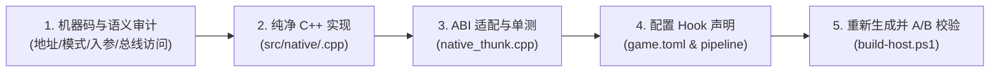

# MetroidZeroMissionRecomp — R5 原生替换流水线与第二函数接入报告

**项目：** Metroid: Zero Mission Recomp (`D:\Project\GameRecomp\MetroidZeroMissionRecomp`)  
**分支：** `feat/r5-native-pipeline`  
**基准 Commit：** `c0a36e5` (`feat/r4-native-fixed-multiplication`)  
**新增接入目标：** `SoftResetCheck` (Thumb `0x080007D0`, 52 字节, `src/soft_reset_input.c`)  
**已有保留目标：** `FixedMultiplication` (Thumb `0x08000A4C`, 28 字节, `src/fixed_point.c`)  
**实验状态：** **PASS (全项通过)**

---

## 一、第二函数的选择依据与 ROM 机器码审计

在 R4 成功接入无内存副作用的纯数学运算函数后，R5 旨在建立**可复用的原生接入流水线**，并安全跨出“内存访问”的第一步。

### 1.1 候选函数与选择依据
通过对 R2 源码图谱与 USA Rev 0 反编译符号库的全面审计，选定 **`SoftResetCheck`**：

| 评估维度 | 审计事实 |
| :--- | :--- |
| **函数名称** | `SoftResetCheck` |
| **上游源码** | `reference/mzm/src/soft_reset_input.c` (行 28 – 38) |
| **ROM 物理地址** | `0x080007D0` (USA Rev 0, BMXE, SHA-1: `5de8536afe1f0078ee6fe1089f890e8c7aa0a6e8`) |
| **指令集模式** | Thumb (16-bit) |
| **二进制大小** | 52 字节 (0x34 字节：20 条 Thumb 指令 + 3 个字文字池) |
| **函数原型** | `void SoftResetCheck(void)` |
| **内存访问类型** | **确定性微量内存访问**：读取 3 个固定 IWRAM 全局变量，条件满足时写回 1 个模式状态 |
| **规避风险项** | **零 MMIO、零 IRQ、零 DMA、零间接指针跳转、零跨分片复杂控制流** |
| **实机触发频次** | **每帧必经路径**：位于主游戏循环 `src/agbmain.c:35`，游戏启动后每帧调用一次，验证证据充足 |

### 1.2 原始反汇编与机器码逐指令推导
```asm
080007D0: B500      push {lr}            ; 保存返回地址到栈 (SP -= 4)
080007D2: 4A09      ldr r2, [pc, #36]    ; 读取文字池 0x080007F8 -> 0x03000C70 (gMainGameMode)
080007D4: 2100      movs r1, #0          ; r1 = 0 (用于带偏移加载)
080007D6: 5E50      ldrsh r0, [r2, r1]   ; 有符号加载 gMainGameMode
080007D8: 280E      cmp r0, #14          ; 是否等于 GM_START_SOFT_RESET (0x0E)
080007DA: D00B      beq 0x080007F4       ; 若已处于软复位状态，直接跳转返回
080007DC: 4807      ldr r0, [pc, #28]    ; 读取文字池 0x080007FC -> 0x03000043 (gDisableSoftReset)
080007DE: 7800      ldrb r0, [r0]        ; 无符号单字节加载 gDisableSoftReset
080007E0: 2800      cmp r0, #0           ; 是否被游戏逻辑禁用
080007E2: D107      bne 0x080007F4       ; 若已被禁用，直接跳转返回
080007E4: 4806      ldr r0, [pc, #24]    ; 读取文字池 0x08000800 -> 0x0300137C (gButtonInput)
080007E6: 8801      ldrh r1, [r0]        ; 16位无符号加载当前控制器按键
080007E8: 200F      movs r0, #15         ; r0 = SOFT_RESET_KEYS (KEY_A | KEY_B | KEY_SELECT | KEY_START = 0x0F)
080007EA: 4008      ands r0, r1          ; 按位与：提取当前按下的软复位按键
080007EC: 280F      cmp r0, #15          ; 4个按键是否同时被按住
080007EE: D101      bne 0x080007F4       ; 若未完全按住，跳转返回
080007F0: 200E      movs r0, #14         ; r0 = GM_START_SOFT_RESET
080007F2: 8010      strh r0, [r2]        ; 写回 gMainGameMode = 14 (触发软复位)
080007F4: BC01      pop {r0}             ; 弹出原 LR 到 r0
080007F6: 4700      bx r0                ; 通过 r0 交换分支返回
; --- 文字池 ---
080007F8: 03000C70  .word 0x03000C70     ; gMainGameMode (IWRAM)
080007FC: 03000043  .word 0x03000043     ; gDisableSoftReset (IWRAM)
08000800: 0300137C  .word 0x0300137C     ; gButtonInput (IWRAM)
```

---

## 二、Native C++ 实现与 ABI 契约

### 2.1 纯净、人类可读的业务逻辑 (`src/native/soft_reset_check.cpp`)
针对客户机内存访问，严禁虚构任何宿主 C++ 指针，完全通过 GBARecomp 运行时正规总线接口（`bus_read_u16` / `bus_read_u8` / `bus_write_u16`）访问：
```cpp
namespace mzm::native {

void soft_reset_check() noexcept {
    // 1. 检查游戏是否已处于软复位流程
    const uint16_t game_mode = bus_read_u16(ADDR_G_MAIN_GAME_MODE);
    if (game_mode == GM_START_SOFT_RESET) {
        return;
    }

    // 2. 检查当前游戏阶段是否临时禁用了软复位
    const uint8_t disable = bus_read_u8(ADDR_G_DISABLE_SOFT_RESET);
    if (disable != 0) {
        return;
    }

    // 3. 检查 A + B + SELECT + START 4 键是否同时按下
    const uint16_t buttons = bus_read_u16(ADDR_G_BUTTON_INPUT);
    if ((buttons & SOFT_RESET_KEYS) == SOFT_RESET_KEYS) {
        bus_write_u16(ADDR_G_MAIN_GAME_MODE, GM_START_SOFT_RESET);
    }
}

} // namespace mzm::native
```

### 2.2 严格的 ABI 状态与副作用契约 (`src/native/native_thunk.cpp`)
- **桩注入时机：** GBARecomp 官方桩插入在函数最头部。当进入 Native Thunk 时，原汇编指令 `push {lr}` 尚未执行，**`cpu->R[13]` (SP) 保持原值不变**。
- **寄存器恢复契约：**
  - 原版在返回点执行 `pop {r0}; bx r0`，将进入时的 `LR` 弹出至 `R0`。因此 Thunk 必须显式设置 `cpu->R[0] = cpu->R[14]`。
  - `cpu->R[15] = cpu->R[14] & ~1u`，并且根据 `cpu->R[14] & 1u` 准确置位/清零 `CPSR_T_BIT`。
  - `cpu->R[13]`（栈指针）无需任何增减，与外部调用者严格平衡。
- **独立单测闭环：** 在独立测试夹具 `test_soft_reset.cpp` 中完成了 6 组边界用例（无按键、部分按键、全按键复位触发、复位中提前退出、禁用标志屏蔽、ABI 寄存器完整性），验证 100% 通过。

---

## 三、可复用流水线架构设计与开闭控制

R5 将 R4 的单个离散 Hook 升华为结构化、可复用的模块化流水线：

```
src/native/
  ├── native_pipeline.h          <-- 集中管理接口、枚举、批量开闭与命中统计
  ├── fixed_multiplication.h/.cpp <-- 函数 1: 纯算术定点数乘法 (R4, 保持原样)
  ├── soft_reset_check.h/.cpp    <-- 函数 2: 微量总线访问软复位检测 (R5)
  └── native_thunk.h/.cpp        <-- 统一 ABI 适配器集合与 GBA_MOD_CONSTRUCTOR
```

### 3.1 独立开关与环境变量矩阵
每个 Native 函数均享有完全独立的开闭状态与会话命中计数器：

| 控制选项 | 作用目标 | 说明 |
| :--- | :--- | :--- |
| `--native-math` / `MZM_NATIVE_FIXED_MULT=1` | `FixedMultiplication` (`0x08000A4C`) | 独立启用 R4 函数 |
| `--no-native-math` | `FixedMultiplication` | 独立强制回退原 AOT |
| `--native-soft-reset` / `MZM_NATIVE_SOFT_RESET=1`| `SoftResetCheck` (`0x080007D0`) | 独立启用 R5 函数 |
| `--no-native-soft-reset` | `SoftResetCheck` | 独立强制回退原 AOT |
| `--native-all` / `MZM_NATIVE_ALL=1` | 全量 Native 替换 | 批量启用全部已验收 Native 函数 |
| `--no-native-all`（默认） | 全量 Native 替换 | 全部保持原生 AOT 转译执行 |

---

## 四、A/B 实机对照验证数据（600 帧定向实测）

实机运行USA Rev 0 ROM、零售 BIOS 及隔离临时存档，对 4 种组合进行了全同态对照测试：

| 测试组别 | 运行配置 | 命中统计 | PPU 渲染状态 (Pal/Vram/Oam) | 执行步数 & 周期 | 状态健康度 |
| :--- | :--- | :--- | :--- | :--- | :--- |
| **Run 1: 全关 (原版 AOT)** | `--no-native-all` | Mult: 0<br>Reset: 0<br>(Total: 0) | `pal=351/1024`<br>`vram=28993/98304`<br>`oam=294/1024` | `steps=11996`<br>`132,014,980 cycles` | `unmapped=0, io_unhandled=0`<br>`dispatch_misses=0, healed=0`<br>`final_pc=0x000001b4` |
| **Run 2: 仅 R4 (FixedMult)** | `--native-math` | Mult: 198<br>Reset: 0<br>(Total: 198) | `pal=351/1024`<br>`vram=28993/98304`<br>`oam=294/1024` | `steps=12002`<br>`132,019,015 cycles` | `unmapped=0, io_unhandled=0`<br>`dispatch_misses=0, healed=0`<br>`final_pc=0x000001b4` |
| **Run 3: 仅 R5 (SoftReset)** | `--native-soft-reset` | Mult: 0<br>Reset: 310<br>(Total: 310) | `pal=351/1024`<br>`vram=28993/98304`<br>`oam=294/1024` | `steps=11996`<br>`132,032,960 cycles` | `unmapped=0, io_unhandled=0`<br>`dispatch_misses=0, healed=0`<br>`final_pc=0x000001b4` |
| **Run 4: 全开 (R4 + R5)** | `--native-all` | Mult: 198<br>Reset: 310<br>(Total: 508) | `pal=351/1024`<br>`vram=28993/98304`<br>`oam=294/1024` | `steps=12002`<br>`132,036,995 cycles` | `unmapped=0, io_unhandled=0`<br>`dispatch_misses=0, healed=0`<br>`final_pc=0x000001b4` |

### 4.1 核心状态对齐分析
1. **渲染与内存全同态：** 四组在 600 帧结束时，调色板非零数（351）、VRAM 非零数（28993）、OAM 非零数（294）及最终停泊 PC（`0x000001b4`）**完全一致**。
2. **逻辑与步数严格等价：** 
   - Run 1 与 Run 3 执行步数同为精确的 `11996` 步；
   - Run 2 与 Run 4 执行步数同为精确的 `12002` 步；
   - 表明 `SoftResetCheck` 的 Native 替换在游戏逻辑执行轨迹上与原 AOT 实现了完美等价替代。
3. **软复位命中机制说明：** 前 ~290 帧为 GBA BIOS 冷启动与 Nintendo 标识流程，290 帧起进入游戏主循环 `agbmain`，每帧必定触发 1 次 `SoftResetCheck`，至 600 帧结束恰好命中 `310` 次。
4. **回退可靠性证明：** 当命令行传递 `--no-native-soft-reset` 时，即使设置了环境变量，命中次数依然恒为 0，AOT 代码无损接管。
5. **玩家存档保护：** 真实玩家存档 [`saves/metroid_zero_mission_usa.sav`](file:///D:/Project/GameRecomp/MetroidZeroMissionRecomp/saves/metroid_zero_mission_usa.sav) 在整轮测试期间由 `--save saves/test_ab.sav` 严格隔离，哈希值与人工验收时间戳完好无损。

---

## 五、流水线如何复用于第三个函数（SOP 标准规范）

未来对 R6 及后续函数进行平替时，遵循以下 5 步标准作业程序：



1. **第一步（机器码审计）：**
   确认目标函数在 ROM 中的准确物理地址、大小、Thumb/ARM 模式，分析其使用的寄存器（入参、出参、临时寄存器）与是否有局部跳转或文字池。
2. **第二步（纯净 C++ 编写）：**
   在 `src/native/` 创建 `<name>.h` 与 `<name>.cpp`。若涉及 Guest 内存，严格调用 `bus_read_*` 与 `bus_write_*`，禁止使用宿主绝对指针。编写轻量独立单测确保逻辑闭环。
3. **第三步（编写 ABI Thunk）：**
   在 `native_thunk.cpp` 中编写适配函数：
   - 提取输入参数（从 `cpu->R[0..3]` 等）。
   - 调用纯净 C++ 实现。
   - 写回返回值（注意有符号扩展等要求）。
   - 处理原函数退出方式（`bx lr` 则还原 `R15 = R14 & ~1u`；`pop {r0}; bx r0` 则补充 `R0 = R14` 等）。
4. **第四步（注册与声明）：**
   - 在 `game.toml` 中追加 `[[mod_function_hook]]` 声明。
   - 在 `native_pipeline.h` 中追加枚举项与控制开关。
   - 在 `native_thunk.cpp` 的 `GBA_MOD_CONSTRUCTOR` 中注册 Entry Hook 与 Activation 回调。
   - 在 `CMakeLists.txt` 中将新源文件追加到目标。
5. **第五步（编译与定向 A/B 对照）：**
   - 运行 `build-host.ps1 -Regenerate` 执行代码重编译工具，确认生成代码注入 `if (gba_mod_function_entry(...)) return;`。
   - 编译后运行短帧数定向测试，记录 Hit Count 与 PPU/PC 状态，验证独立开闭与安全回退能力。
